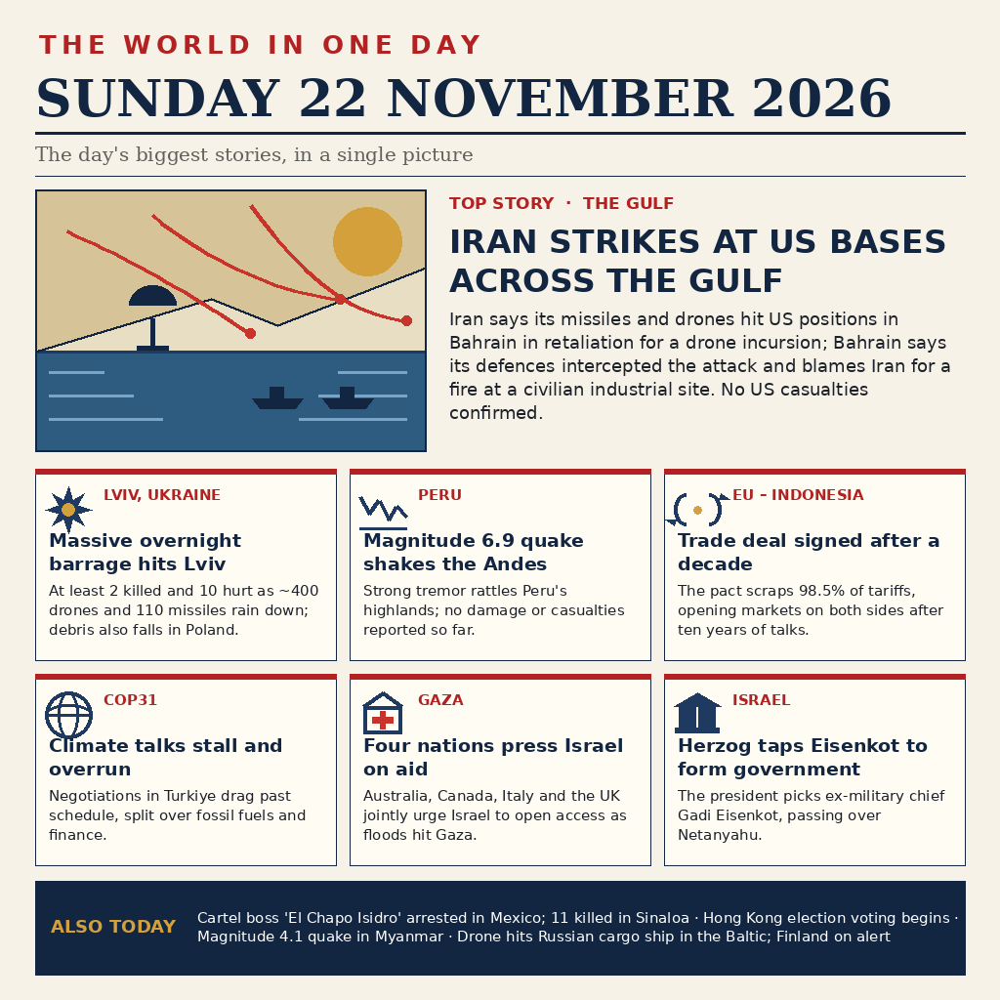

# The World in One Day — Sunday 22 November 2026

A single front-page poster that sums up Sunday 22 November 2026's world news in one image — an entry for the [make.fun bounty "Sum up 22 November's world news in one image"](https://make.fun/bounty/news-image-20261122).

## What's on the poster

**Top story — The Gulf.** Overnight, Iran's Revolutionary Guard fired missiles and drones at US positions in Bahrain, saying it was answering an American drone's airspace violation and a strike on radar on Hengam Island. Tehran claims two US Patriot radars were destroyed; Bahrain says its air defences intercepted the attack and accuses Iran of hitting a civilian industrial site that caught fire. At least three tankers were attacked near the Strait of Hormuz, Kuwaiti defences intercepted hostile targets, and Jordan shot down five missiles near Azraq. No US casualties or base damage have been confirmed.

**Six more stories:**

- **Lviv, Ukraine** — A massive overnight barrage kills at least 2 and injures 10 in Lviv; around 400 drones and 110 missiles are fired, with debris also falling in Poland.
- **Peru** — A magnitude 6.9 earthquake shakes the Peruvian Andes; no damage or casualties reported so far.
- **EU – Indonesia** — A trade deal is signed after a decade of talks, scrapping 98.5% of tariffs.
- **COP31** — Climate negotiations in Turkiye stall and overrun, split over fossil fuels and finance.
- **Gaza** — Australia, Canada, Italy and the UK jointly press Israel to open aid access as Gaza floods.
- **Israel** — President Herzog asks former military chief Gadi Eisenkot to form the next government, passing over Netanyahu.

**Also today (footer ticker):** the arrest of cartel boss "El Chapo Isidro" in Mexico and violence killing 11 in Sinaloa; Hong Kong election voting begins; a magnitude 4.1 quake in Myanmar; a drone hits a Russian cargo ship in the Baltic and Finland goes on alert.

## How it works

- `poster.py` — a Python program that draws the whole poster with Pillow (warm paper background, navy ink, red accents). Every illustration and icon is drawn in code, and all text is word-wrapped to fit its box. Run `python3 poster.py` to regenerate `entry.png` (1024×1024).
- `main.ts` — the Node entry point. It copies `entry.png` into the directory from the `MAKEFUN_OUTPUT_DIR` environment variable (default `/output`), creating the directory if needed, and prints the number of bytes written. It uses only the Node standard library and no network, so running it twice gives byte-identical output.
- `entry.png` — the finished poster, 1024×1024.

## License

MIT — see [LICENSE](LICENSE).

New to make.fun? I got started through this link, and it supports my entries at no cost to you: https://make.fun/r/vy8jjegg
